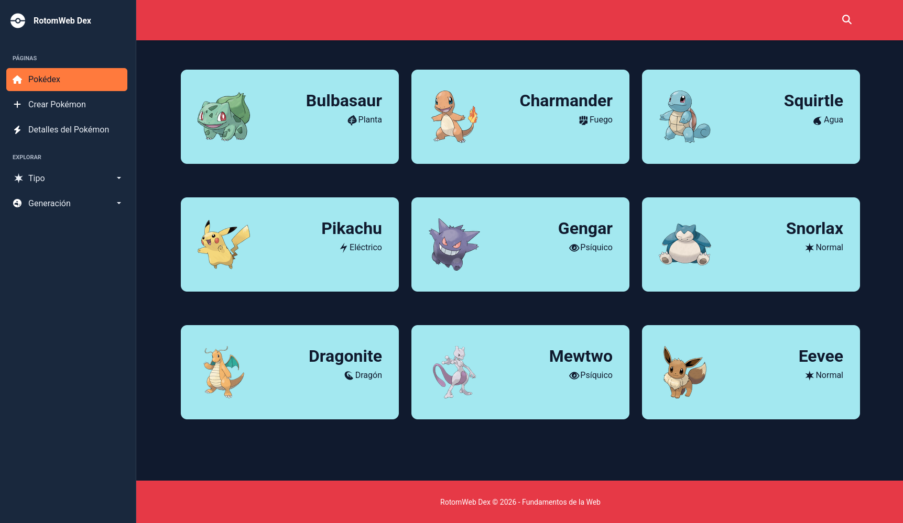
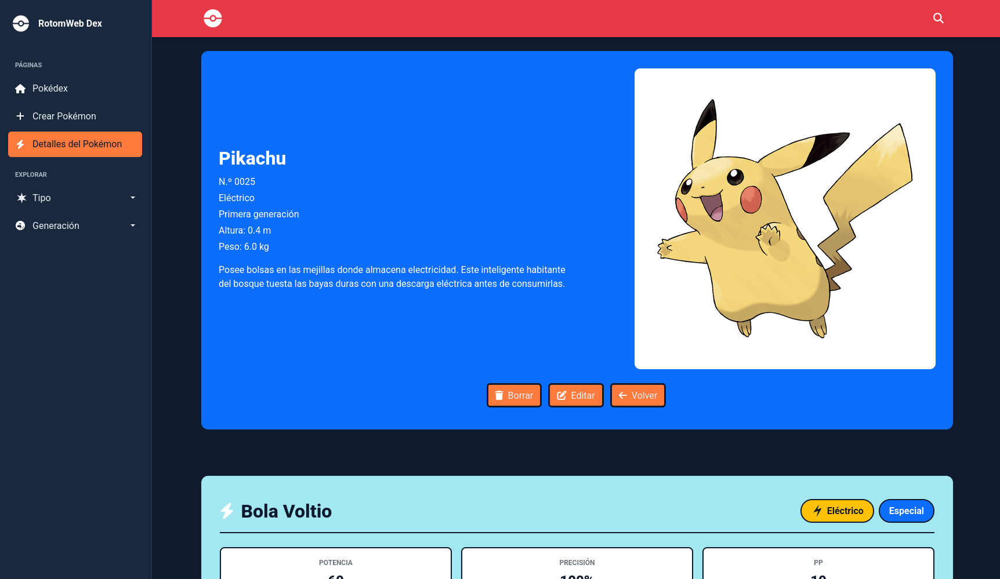
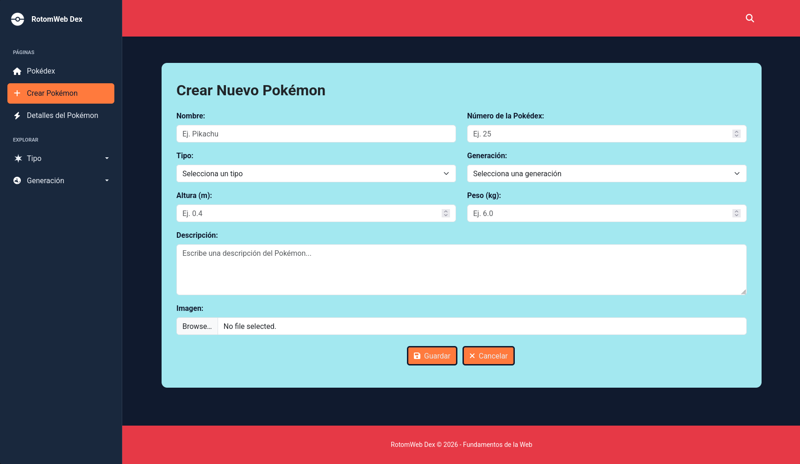

# RotomWeb Dex

Our goal is to make a Pokémon encyclopedia website called **RotomWeb Dex**.

## Development Team Members
* **Adrián Molero Miñana** | `a.molero.2024@alumnos.urjc.es` | GitHub: [@S0cr4te5](https://github.com/S0cr4te5)
* **Marcos Vidal Castillo** | `m.vidalc.2024@alumnos.urjc.es` | GitHub: [@Marcos-VC](https://github.com/Marcos-VC)
* **Lucas Román Jiménez** | `l.roman.2024@alumnos.urjc.es` | GitHub: [@Lucas-Roman-Jimenez](https://github.com/Lucas-Roman-Jimenez)
* **Omar Pozo Adán** | `o.pozoa.2024@alumnos.urjc.es` | GitHub: [@OmarPozoAdan](https://github.com/OmarPozoAdan)

---

## Functionality

### Entities

#### Main Entity (Pokémon)
Represents individual Pokémon entries in the encyclopedia.
* **Attributes:**
  * `name`: Text
  * `pokedex_number`: Int
  * `type`: Text
  * `generation`: Int (1-9)
  * `height`: Float (0.1-100)
  * `weight`: Float (0.1-1000)
  * `description`: Text

#### Secondary Entity (Abilities / Moves)
Represents attacks or abilities associated with a Pokémon.
* **Attributes:**
  * `name`: Text
  * `type`: Text
  * `category`: Text
  * `power`: Int (0-5050)
  * `accuracy`: Int (30-100)
  * `pp`: Int (1-160)
  * `description`: Text

### Images
Entities have associated images to complement their visualization:
* **Pokémon:** Each Pokémon has an uploaded main artwork image.
* **Move:** Moves include icons representing the move's type and category.

### Search, Filtering, and Categorization
* **Search:** Text search box to find Pokémon by name.
* **Filtering:** Filter Pokémon according to their region or generation.
* **Categorization:** Tag/button system to group and display Pokémon by their elemental type.

---

## Práctica 1: HTML & CSS Layout

### Screenshots

#### Main Page (`home.html`)

#### Details Page (`pokemon-details.html`)

#### New Element Page (`new-pokemon.html`)

---

### Member Contributions

#### Adrián Molero Miñana (@S0cr4te5)
* **Task Description:** Worked on... *(añadir un párrafo breve explicando qué hizo)*.
* **Top 5 Commits:**
  1. [Commit 1 Title](https://github.com/CodeURJC-FW-2026-27/webapp11/commit/COMMIT_HASH_1)
  2. [Commit 2 Title](https://github.com/CodeURJC-FW-2026-27/webapp11/commit/COMMIT_HASH_2)
  3. [Commit 3 Title](https://github.com/CodeURJC-FW-2026-27/webapp11/commit/COMMIT_HASH_3)
  4. [Commit 4 Title](https://github.com/CodeURJC-FW-2026-27/webapp11/commit/COMMIT_HASH_4)
  5. [Commit 5 Title](https://github.com/CodeURJC-FW-2026-27/webapp11/commit/COMMIT_HASH_5)
* **Top 5 Files:**
  1. [`home.html`](https://github.com/CodeURJC-FW-2026-27/webapp11/blob/main/home.html)
  2. [`custom.css`](https://github.com/CodeURJC-FW-2026-27/webapp11/blob/main/custom.css)
  3. [`style.css`](https://github.com/CodeURJC-FW-2026-27/webapp11/blob/main/style.css)
  4. [`pokemon.html`](https://github.com/CodeURJC-FW-2026-27/webapp11/blob/main/pokemon.html)
  5. [`new-pokemon.html`](https://github.com/CodeURJC-FW-2026-27/webapp11/blob/main/new-pokemon.html)

#### Marcos Vidal Castillo (@Marcos-VC)
* **Task Description:** Worked mainly on the new pokemon view, though I also reviewed the main style of the page, helped with other issues and wrote comments to structure the code.
* **Top 5 Commits:**
  1. [create new-pokemon.html](https://github.com/CodeURJC-FW-2026-27/webapp11/commit/2c73dc77f8eb236e2883802dec676c0da5ac892b)
  2. [new-pokemon basic structure](https://github.com/CodeURJC-FW-2026-27/webapp11/commit/9509f203aeafe5e931777261b835d64fe3deb93c)
  3. [sidebar added to new pokemon](https://github.com/CodeURJC-FW-2026-27/webapp11/commit/1f231c24cb30191ec9d8ed684833f2b6d7ca05c2)
  4. [fully responsive pokemon + comments](https://github.com/CodeURJC-FW-2026-27/webapp11/commit/cc6be3e68f7efa3cec1a948585600d8faba5205b)
  5. [More comments and structure](https://github.com/CodeURJC-FW-2026-27/webapp11/commit/5f5746b6850ff46360f697d75750ee1ae8a9e4cc)
* **Top 5 Files:**
  1. [`pokemon.html`](https://github.com/CodeURJC-FW-2026-27/webapp11/blob/main/pokemon.html)
  2. [`custom.css`](https://github.com/CodeURJC-FW-2026-27/webapp11/blob/main/custom.css)
  3. [`home.html`](https://github.com/CodeURJC-FW-2026-27/webapp11/blob/main/home.html)
  4. [`new-pokemon.html`](https://github.com/CodeURJC-FW-2026-27/webapp11/blob/main/new-pokemon.html)
  5. [`README.md`](https://github.com/CodeURJC-FW-2026-27/webapp11/blob/main/README.md)

#### Lucas Román Jiménez (@Lucas-Roman-Jimenez)
* **Task Description:** Worked on creating the Pokemon page, fixing most of the problems that occurred, as well as filling all the information relevant to the example of the Pokemon page.
* **Top 5 Commits:**
  1. [Added Pokemon Page and modified the CSS file to adapt the buttons](https://github.com/CodeURJC-FW-2026-27/webapp11/commit/80a2472a3bf5d4f50686bc04d624132caf32f7a6)
  2. [new movement form](https://github.com/CodeURJC-FW-2026-27/webapp11/commit/93cd62a5490b72ad0527c5eb8fea86accc0fbb63)
  3. [Fixed display of pokemons](https://github.com/CodeURJC-FW-2026-27/webapp11/commit/189165a026a47f23407aa51d605629a972c8cd61)
  4. [Fixed minor issues with the buttons and the new movement form](https://github.com/CodeURJC-FW-2026-27/webapp11/commit/fff31b0e0375a87e180a2cbf4e43446ccf45ad25)
  5. [Filled information in pokemon.html](https://github.com/CodeURJC-FW-2026-27/webapp11/commit/ae844bc0cea3d021cf191dab330a5a6f3b8dc1a7)
* **Top 5 Files:**
  1. [`pokemon.html`](https://github.com/CodeURJC-FW-2026-27/webapp11/blob/main/pokemon.html)
  2. [`custom.css`](https://github.com/CodeURJC-FW-2026-27/webapp11/blob/main/custom.css)
  3. [`home.html`](https://github.com/CodeURJC-FW-2026-27/webapp11/blob/main/home.html)
  4. [`new-pokemon.html`](https://github.com/CodeURJC-FW-2026-27/webapp11/blob/main/new-pokemon.html)
  5. [`README.md`](https://github.com/CodeURJC-FW-2026-27/webapp11/blob/main/README.md)

#### Omar Pozo Adán (@OmarPozoAdan)
* **Task Description:** Worked on... *(añadir un párrafo breve explicando qué hizo)*.
* **Top 5 Commits:**
  1. [Commit 1 Title](https://github.com/CodeURJC-FW-2026-27/webapp11/commit/COMMIT_HASH_1)
  2. [Commit 2 Title](https://github.com/CodeURJC-FW-2026-27/webapp11/commit/COMMIT_HASH_2)
  3. [Commit 3 Title](https://github.com/CodeURJC-FW-2026-27/webapp11/commit/COMMIT_HASH_3)
  4. [Commit 4 Title](https://github.com/CodeURJC-FW-2026-27/webapp11/commit/COMMIT_HASH_4)
  5. [Commit 5 Title](https://github.com/CodeURJC-FW-2026-27/webapp11/commit/COMMIT_HASH_5)
* **Top 5 Files:**
  1. [`home.html`](https://github.com/CodeURJC-FW-2026-27/webapp11/blob/main/home.html)
  2. [`custom.css`](https://github.com/CodeURJC-FW-2026-27/webapp11/blob/main/custom.css)
  3. [`pokemon.html`](https://github.com/CodeURJC-FW-2026-27/webapp11/blob/main/pokemon.html)
  4. [`new-pokemon.html`](https://github.com/CodeURJC-FW-2026-27/webapp11/blob/main/new-pokemon.html)
  5. [`README.md`](https://github.com/CodeURJC-FW-2026-27/webapp11/blob/main/README.md)
