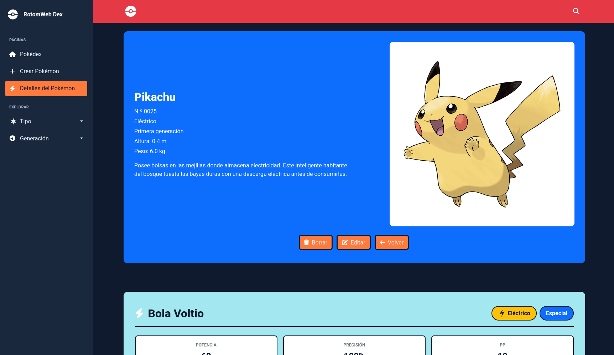
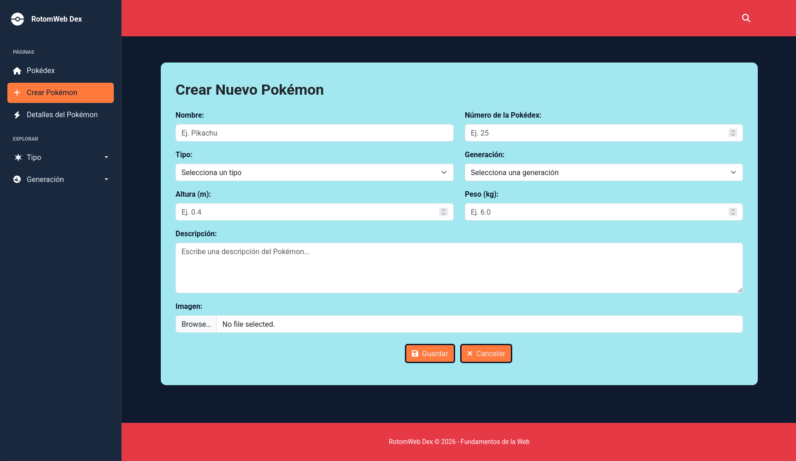

# RotomWeb Dex

Our goal is to make a Pokémon encyclopedia website called **RotomWeb Dex**.

## Development Team Members
* **Adrián Molero Miñana** | `a.molero.2024@alumnos.urjc.es` | GitHub: [@S0cr4te5](https://github.com/S0cr4te5)
* **Marcos Vidal Castillo** | `m.vidalc.2024@alumnos.urjc.es` | GitHub: [@Marcos-VC](https://github.com/Marcos-VC)
* **Lucas Román Jiménez** | `l.roman.2024@alumnos.urjc.es` | GitHub: [@Lucas-Roman-Jimenez](https://github.com/Lucas-Roman-Jimenez)
* **Omar Pozo Adán** | `o.pozoa.2024@alumnos.urjc.es` | GitHub: [@OmarPozoAdan](https://github.com/OmarPozoAdan)

---

## Functionality

### Entities

#### Main Entity (Pokémon)
Represents individual Pokémon entries in the encyclopedia.
* **Attributes:**
  * `name`: Text
  * `pokedex_number`: Int
  * `type`: Text
  * `generation`: Int (1-9)
  * `height`: Float (0.1-100)
  * `weight`: Float (0.1-1000)
  * `description`: Text

#### Secondary Entity (Abilities / Moves)
Represents attacks or abilities associated with a Pokémon.
* **Attributes:**
  * `name`: Text
  * `type`: Text
  * `category`: Text
  * `power`: Int (0-5050)
  * `accuracy`: Int (30-100)
  * `pp`: Int (1-160)
  * `description`: Text

### Images
Entities have associated images to complement their visualization:
* **Pokémon:** Each Pokémon has an uploaded main artwork image.
* **Move:** Moves may include icons representing the move's type and category.

### Search, Filtering, and Categorization
* **Search:** Text search box to find Pokémon by name.
* **Filtering:** Filter Pokémon according to their region or generation.
* **Categorization:** Tag/button system to group and display Pokémon by their elemental type.

---

## Práctica 1: HTML & CSS Layout

### Screenshots

#### Main Page (`index.html`)


#### Details Page (`pokemon-details.html`)


#### New Element Page (`new-pokemon.html`)


---

### Member Contributions

#### Adrián Molero Miñana (@S0cr4te5)
* **Task Description:** Worked mainly on the home view, though I also reviewed and worked in new-pokemon, pokemon and gave the basic structure and design of the web. 
* **Top 5 Commits:**
  1. [Added Home Page](https://github.com/CodeURJC-FW-2026-27/webapp11/commit/5026281fdf01c7fe8e7ed02a67213d4627e1f4a8)
  2. [Unified CSS](https://github.com/CodeURJC-FW-2026-27/webapp11/commit/a515cb49c809e0030d7bf155d584476c11bc7e4a)
  3. [Mobile capabilities added to the home page](https://github.com/CodeURJC-FW-2026-27/webapp11/commit/2ea96c0135a662758a143e46ff0998e3813e478f)
  4. [Enhance navbar styles and add Pokémon cards to home page](https://github.com/CodeURJC-FW-2026-27/webapp11/commit/ce17b226ecc633583bd80aaa7971116324db7a74)
  5. [Filtering and categorization](https://github.com/CodeURJC-FW-2026-27/webapp11/commit/b1d25b42aacf19f3a2d06393a92829d8a0c91e9b)
* **Top 5 Files:**
  1. [`home.html`](https://github.com/CodeURJC-FW-2026-27/webapp11/blob/main/home.html)
  2. [`custom.css`](https://github.com/CodeURJC-FW-2026-27/webapp11/blob/main/custom.css)
  3. [`style.css`](https://github.com/CodeURJC-FW-2026-27/webapp11/blob/main/style.css)
  4. [`pokemon.html`](https://github.com/CodeURJC-FW-2026-27/webapp11/blob/main/pokemon.html)
  5. [`new-pokemon.html`](https://github.com/CodeURJC-FW-2026-27/webapp11/blob/main/new-pokemon.html)

#### Marcos Vidal Castillo (@Marcos-VC)
* **Task Description:** Worked mainly on the new pokemon view, though I also reviewed the main style of the page, helped with other issues and wrote comments to structure the code.
* **Top 5 Commits:**
  1. [create new-pokemon.html](https://github.com/CodeURJC-FW-2026-27/webapp11/commit/2c73dc77f8eb236e2883802dec676c0da5ac892b)
  2. [new-pokemon basic structure](https://github.com/CodeURJC-FW-2026-27/webapp11/commit/9509f203aeafe5e931777261b835d64fe3deb93c)
  3. [sidebar added to new pokemon](https://github.com/CodeURJC-FW-2026-27/webapp11/commit/1f231c24cb30191ec9d8ed684833f2b6d7ca05c2)
  4. [fully responsive pokemon + comments](https://github.com/CodeURJC-FW-2026-27/webapp11/commit/cc6be3e68f7efa3cec1a948585600d8faba5205b)
  5. [More comments and structure](https://github.com/CodeURJC-FW-2026-27/webapp11/commit/5f5746b6850ff46360f697d75750ee1ae8a9e4cc)
* **Top 5 Files:**
  1. [`pokemon.html`](https://github.com/CodeURJC-FW-2026-27/webapp11/blob/main/pokemon.html)
  2. [`custom.css`](https://github.com/CodeURJC-FW-2026-27/webapp11/blob/main/custom.css)
  3. [`home.html`](https://github.com/CodeURJC-FW-2026-27/webapp11/blob/main/home.html)
  4. [`new-pokemon.html`](https://github.com/CodeURJC-FW-2026-27/webapp11/blob/main/new-pokemon.html)
  5. [`README.md`](https://github.com/CodeURJC-FW-2026-27/webapp11/blob/main/README.md)

#### Lucas Román Jiménez (@Lucas-Roman-Jimenez)
* **Task Description:** Worked on creating the Pokemon page, fixing most of the problems that occurred, as well as filling all the information relevant to the example of the Pokemon page.
* **Top 5 Commits:**
  1. [Added Pokemon Page and modified the CSS file to adapt the buttons](https://github.com/CodeURJC-FW-2026-27/webapp11/commit/80a2472a3bf5d4f50686bc04d624132caf32f7a6)
  2. [new movement form](https://github.com/CodeURJC-FW-2026-27/webapp11/commit/93cd62a5490b72ad0527c5eb8fea86accc0fbb63)
  3. [Fixed display of pokemons](https://github.com/CodeURJC-FW-2026-27/webapp11/commit/189165a026a47f23407aa51d605629a972c8cd61)
  4. [Fixed minor issues with the buttons and the new movement form](https://github.com/CodeURJC-FW-2026-27/webapp11/commit/fff31b0e0375a87e180a2cbf4e43446ccf45ad25)
  5. [Filled information in pokemon.html](https://github.com/CodeURJC-FW-2026-27/webapp11/commit/ae844bc0cea3d021cf191dab330a5a6f3b8dc1a7)
* **Top 5 Files:**
  1. [`pokemon.html`](https://github.com/CodeURJC-FW-2026-27/webapp11/blob/main/pokemon.html)
  2. [`custom.css`](https://github.com/CodeURJC-FW-2026-27/webapp11/blob/main/custom.css)
  3. [`home.html`](https://github.com/CodeURJC-FW-2026-27/webapp11/blob/main/home.html)
  4. [`new-pokemon.html`](https://github.com/CodeURJC-FW-2026-27/webapp11/blob/main/new-pokemon.html)
  5. [`README.md`](https://github.com/CodeURJC-FW-2026-27/webapp11/blob/main/README.md)

#### Omar Pozo Adán (@OmarPozoAdan)
* **Task Description:** Worked on web structure, implementation of sidebar for category visualization, fixing and debugging errors affecting web design on mobile view, as well as checking that all documents met the rules marked on the practice's description.
* **Top 5 Commits:**
  1. [Generation of a fixed navigation sidebar](https://github.com/CodeURJC-FW-2026-27/webapp11/commit/54df5ad85e6a38ef09c87e65b2f7360ef54062dd)
  2. [Standard unique navigation section and trigger buttons on mobile display](https://github.com/CodeURJC-FW-2026-27/webapp11/commit/5dfd9e7a9256d65e636ef283eb8de67396165e12)
  3. [Implementation of mobile navigation on the rest of pages and fixing of minor errors](https://github.com/CodeURJC-FW-2026-27/webapp11/commit/b66303da4482b1df09e1b76dd635b8ad5ddcee74)
  4. [MObile visibility fix on pokemon page](https://github.com/CodeURJC-FW-2026-27/webapp11/commit/bf731aa341861d54fd66701f2bf55c4223e3650e)
  5. [Copyright tag established in all HTML page footer](https://github.com/CodeURJC-FW-2026-27/webapp11/commit/882470dc0f3ec25dc1d2f1ba63a44ef295f1c3f8)
* **Top 5 Files:**
  1. [`home.html`](https://github.com/CodeURJC-FW-2026-27/webapp11/blob/main/home.html)
  2. [`custom.css`](https://github.com/CodeURJC-FW-2026-27/webapp11/blob/main/custom.css)
  3. [`pokemon.html`](https://github.com/CodeURJC-FW-2026-27/webapp11/blob/main/pokemon.html)
  4. [`new-pokemon.html`](https://github.com/CodeURJC-FW-2026-27/webapp11/blob/main/new-pokemon.html)
  5. [`README.md`](https://github.com/CodeURJC-FW-2026-27/webapp11/blob/main/README.md)

## Práctica 2

### Execution Instructions

#### Requirements
* **Node.js**: v18.x or higher
* **MongoDB**: v6.0 or higher (running on port `27017`)
* **npm**: v9.x or higher

#### Steps to Run
```bash
# Clone the repository and enter the directory
git clone https://github.com/CodeURJC-FW-2026-27/webapp11.git
cd webapp11

# Install dependencies
npm install

# Start MongoDB service (in a separate terminal or background)
mongod

# Start the application
npm start
```
Access the application in your browser at `http://localhost:3000/`.

---

### File Description
* **`app.js`**: Application entry point. Configures Express, static file serving (`/public` and `/uploads`), and Mustache Express template engine.
* **`src/router.js`**: Main controller handling database initialization (`initDb`), pagination, search, filters, image uploads with Multer, form validations, and CRUD routes for Pokémon and moves.
* **`data/pokemons.json`**: Initial dataset used to seed MongoDB on application startup when empty.
* **`views/header.html` & `views/footer.html`**: Reusable Mustache partials for navigation and footer layout.
* **`views/index.html`**: Main Pokédex view displaying the paginated Pokémon grid.
* **`views/pokemon.html`**: Detail view displaying Pokémon info, artwork, moves, and action forms.
* **`views/new-pokemon.html`**: Reusable form template for creating and editing Pokémon.
* **`views/ability.html`**: Form view for editing an existing Pokémon move.
* **`views/confirmation.html`**: Reusable confirmation page for create, edit, and delete operations.
* **`views/error.html` & `views/form-error.html`**: Error page and partial for validation and server error display.

---

### Demonstration Video
* **YouTube Video Link**: [Demonstration Video] (https://www.youtube.com/)

---

### Member Contributions

#### Adrián Molero Miñana (@S0cr4te5)
* **Task Description:** Responsible for MongoDB connection and initial seeding with demo JSON data and images, refactoring the application architecture with Mustache partials, rendering Pokémon details dynamically from the database, implementing the deletion of Pokémon and abilities, and unifying Pokémon creation and edition forms.
* **Top 5 Commits:**
  1. [Refactor code structure and implemented MongoDB](https://github.com/CodeURJC-FW-2026-27/webapp11/commit/d1cbcd575c0c05314c0388a4a2e67106577d796e)
  2. [Refactor HTML structure with Mustache partials](https://github.com/CodeURJC-FW-2026-27/webapp11/commit/4b9ab9f9b029e775e4fd247a312aebab3644d849)
  3. [Implemented Pokémon details rendering with the database](https://github.com/CodeURJC-FW-2026-27/webapp11/commit/4b7adb4a7e5e439112fc114e61b57a1e0fe8a9e7)
  4. [Implemented deletion for Pokemon](https://github.com/CodeURJC-FW-2026-27/webapp11/commit/d0a217eb23d09aba3748d01efd7b321f7bed5076)
  5. [Unified Pokemon creation and edition](https://github.com/CodeURJC-FW-2026-27/webapp11/commit/a496c1b665afde079a637c58dea106dee3c99abe)
* **Top 5 Files:**
  1. [`router.js`](https://github.com/CodeURJC-FW-2026-27/webapp11/blob/main/src/router.js)
  2. [`pokemon.html`](https://github.com/CodeURJC-FW-2026-27/webapp11/blob/main/views/pokemon.html)
  3. [`new-pokemon.html`](https://github.com/CodeURJC-FW-2026-27/webapp11/blob/main/views/new-pokemon.html)
  4. [`index.html`](https://github.com/CodeURJC-FW-2026-27/webapp11/blob/main/views/index.html)
  5. [`confirmation.html`](https://github.com/CodeURJC-FW-2026-27/webapp11/blob/main/views/confirmation.html)

#### Marcos Vidal Castillo (@Marcos-VC)
* **Task Description:** In charge of pagination, search, categories and filters, helped with mustache templates to avoid dupped code, fixed some errors in other funtionalities..
* **Top 5 Commits:**
  1. [working pagination](https://github.com/CodeURJC-FW-2026-27/webapp11/commit/c8240dff897ee83d6dbeba8f72bc08dbedec8a1f)
  2. [searching bar + filters](https://github.com/CodeURJC-FW-2026-27/webapp11/commit/bf08d316c8a7532eb93cba73327097224f82f74a)
  3. [better filters](https://github.com/CodeURJC-FW-2026-27/webapp11/commit/f87e44abc992548fed60090341adfa27733400ad)
  4. [fix edit pokemon link](https://github.com/CodeURJC-FW-2026-27/webapp11/commit/0d57270c8be1d3a48a2efd4d08c323f30aaccc0d)
  5. [category fix](https://github.com/CodeURJC-FW-2026-27/webapp11/commit/e58973916040da6f0de2c5f1aa53f1e6e664887c)
* **Top 5 Files:**
  1. [`index.html`](https://github.com/CodeURJC-FW-2026-27/webapp11/blob/main/home.html)
  2. [`pokemon.html`](https://github.com/CodeURJC-FW-2026-27/webapp11/blob/main/pokemon.html)
  3. [`new-pokemon.html`](https://github.com/CodeURJC-FW-2026-27/webapp11/blob/main/new-pokemon.html)
  4. [`custom.css`](https://github.com/CodeURJC-FW-2026-27/webapp11/blob/main/custom.css)
  5. [`README.md`](https://github.com/CodeURJC-FW-2026-27/webapp11/blob/main/README.md) 

#### Lucas Román Jiménez (@Lucas-Roman-Jimenez)
* **Task Description:** In charge of client and server validation for both primary (Pokémon) and secondary (Abilities) entities, entity routes, initial database seeding logic, and image upload serving.
* **Top 5 Commits:**
  1. 
  2. 
  3. 
  4. 
  5. 
* **Top 5 Files:**
  1. 
  2. 
  3. 
  4. 
  5. 

#### Omar Pozo Adán (@OmarPozoAdan)
* **Task Description:** In charge of implementing and refactoring the error page (`error.html` and `form-error.html` partial) with demonstration cases, error route rendering, and reviewing responsive layout and Mustache structure. Helped fixing different mistakes of different views such as the display of Pokemons' movements.
* **Top 5 Commits:**
  1. [Implemented error page] (https://github.com/CodeURJC-FW-2026-27/webapp11/commit/a6709ca8c8caa125edb888e0fcd43bf887d2ac90) 
  2. [Fixed showing movements for each pokemon with Mustache.] (https://github.com/CodeURJC-FW-2026-27/webapp11/commit/094da931b30661b1b6ea5d237cf67a03e8d5cbe6)
  3. [Established error messages on forms with four different demonstration cases] (https://github.com/CodeURJC-FW-2026-27/webapp11/commit/353c95d7dacecad680745e7598fb18f00deeeb78)
  4. [Rendering error page correctly instead of form-error.] (https://github.com/CodeURJC-FW-2026-27/webapp11/commit/70c3a9d4e1eccc192c7b5fc250e5d6dbd387eb3d)
  5. [Modified error and form-error views.] (https://github.com/CodeURJC-FW-2026-27/webapp11/commit/da78b84eb8f30a3e0dbb5518667e8ad63ee87cc4)
* **Top 5 Files:**
  1. [form-error.html] (https://github.com/CodeURJC-FW-2026-27/webapp11/blob/main/views/form-error.html)
  2. [error.html] (https://github.com/CodeURJC-FW-2026-27/webapp11/blame/main/views/error.html)
  3. [pokemon.html] (https://github.com/CodeURJC-FW-2026-27/webapp11/blob/main/views/pokemon.html)
  4. [router.js] (https://github.com/CodeURJC-FW-2026-27/webapp11/blame/main/src/router.js)
  5. [custom.css] (https://github.com/CodeURJC-FW-2026-27/webapp11/blob/main/public/custom.css)

